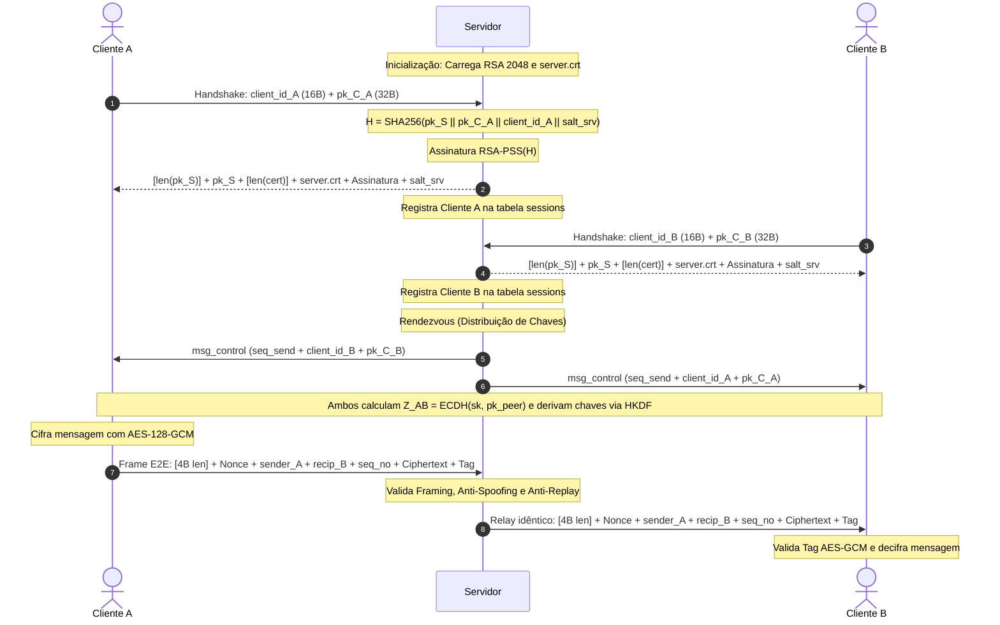

# Trabalho Prático 3: Sistema de Mensageria Segura Multi-Cliente (E2E)
**Disciplina:** Segurança da Informação  
**Professor:** Michel Sales  
**Implementação:** **Apenas o Lado do Servidor** (`servidor.py`)

---

## 1. Visão Geral da Arquitetura do Servidor

O servidor implementado em [`servidor.py`](file:///C:/Users/WIN10/Documents/Trabalho_segurança2/servidor.py) opera em conformidade estrita com os requisitos de segurança e operacionais definidos no Trabalho Prático 3:

- **Papel de Relay (Zero-Knowledge):** O servidor atua exclusivamente como roteador e intermediário (*rendezvous/relay*). Ele **não armazena chaves simétricas e não decifra** nenhuma mensagem transmitida entre os clientes.
- **Autenticação com RSA-PSS:** O servidor possui um par de chaves RSA de 2048 bits e um certificado X.509 autoassinado (`server.crt`). Durante o handshake, ele assina digitalmente os dados da sessão com RSA-PSS (SHA-256) para provar sua identidade e impedir ataques *Man-In-The-Middle* (MITM).
- **Rendezvous e Distribuição de Chaves Públicas:** Ao registrar um novo cliente, o servidor compartilha sua chave pública efêmera X25519 (32 bytes raw) com os demais pares conectados e vice-versa, permitindo que os clientes derivem suas chaves simétricas ponta-a-ponta via HKDF.
- **Proteções Ativas de Segurança:**
  - **Framing TCP:** Validação rigorosa do prefixo de 4 bytes (big-endian) em cada frame. Tamanhos inválidos provocam erro e desconexão imediata.
  - **Anti-Spoofing:** O servidor valida se o `sender_id` no cabeçalho do frame corresponde ao `client_id` autenticado na sessão TCP.
  - **Anti-Replay:** Controle monotônico estritamente crescente do `seq_no` por par remetente/destinatário.
  - **Limpeza de Sessão:** Ao desconectar, todos os estados em memória e contadores são apagados. Reconexões exigem handshake completo do zero.
  - **Conformidade de Logs:** Nenhuma chave privada, segredo compartilhado, salt em texto claro, nonce ou conteúdo de mensagem é exibido no console.

---

## 2. Estrutura de Dados no Servidor (`sessions`)

A tabela em memória segue fielmente a especificação (Página 5 e Página 9 do PDF):

```python
sessions = {
    client_id: {
        "writer": StreamWriter,
        "public_key": pk_C (32B),
        "seq_recv": último seq_no recebido do cliente (inicializado com -1),
        "seq_send": próximo seq_no para mensagens administrativas do servidor (inicializado com 0),
        "salt": salt_srv (16B),
        "last_seq_per_recipient": {}  # Dicionário de controle anti-replay por destinatário
    }
}
```

---

## 3. Fluxo de Comunicação do Protocolo



---

## 4. Arquivos do Projeto

- [`servidor.py`](file:///C:/Users/WIN10/Documents/Trabalho_segurança2/servidor.py): Código-fonte completo, limpo, modular e comentado do servidor.
- [`test_server.py`](file:///C:/Users/WIN10/Documents/Trabalho_segurança2/test_server.py): Suite de testes automatizada que valida os 4 testes mínimos exigidos para a apresentação.
- `server.crt`: Certificado X.509 DER gerado automaticamente pelo servidor.
- `server.key`: Chave privada RSA (2048 bits) do servidor gerada e persistida localmente.

---

## 5. Como Executar

### Pré-requisitos
- Python 3.10 ou superior
- Biblioteca `cryptography` instalada (`pip install cryptography`)

### Passo 1: Iniciar o Servidor
Abra um terminal na pasta do projeto e execute:
```powershell
python servidor.py
```
O servidor inicializará na porta local `8888`, gerará o par RSA e o certificado `server.crt` (se ainda não existirem) e ficará pronto para receber conexões.

### Passo 2: Executar a Bateria de Testes Obrigatórios
Em outro terminal (com o servidor em execução), execute:
```powershell
python test_server.py
```

O script executará automaticamente:
1. **Conexão e Handshake Autenticado:** Conecta 2 clientes simulados, valida a assinatura RSA-PSS do servidor e realiza a troca de mensagem E2E cifrada com sucesso.
2. **Teste de Adulteração (Bitflip):** Simula um ataque em trânsito alterando 1 bit do pacote cifrado; o receptor detecta e rejeita por falha na tag AES-GCM.
3. **Teste de Replay:** Reenvia um frame com `seq_no` antigo; o servidor detecta o replay e rejeita o encaminhamento.
4. **Teste de Framing Inválido:** Envia pacote com tamanho incorreto (< 68 bytes); o servidor rejeita o frame e encerra a conexão de forma segura.

---

## 6. Roteiro para Apresentação (Checklist da Página 10)

Durante a apresentação com o professor, os tópicos podem ser distribuídos da seguinte forma:

1. **Apresentação e Visão Geral:** Explicar o papel do servidor como *relay* ponta-a-ponta sem capacidade de decifração (*zero-knowledge*).
2. **Handshake e Autenticação RSA-PSS:** Mostrar a função `perform_handshake()`, a criação do certificado autoassinado `server.crt` e o cálculo de $H = \text{SHA256}(pk_S \parallel pk_C \parallel client\_id \parallel salt\_srv)$.
3. **Estrutura de Dados e Sessões:** Mostrar o dicionário `sessions`, explicando os campos `writer`, `public_key`, `seq_send`, `seq_recv` e `salt`.
4. **Mecanismos de Segurança e Validações:**
   - Validação de Framing de 4 bytes.
   - Verificação Anti-Spoofing (`sender_id == client_id`).
   - Verificação Anti-Replay com contadores monotônicos (`seq_no`).
5. **Demonstração Prática:** Executar `python servidor.py` e em seguida `python test_server.py`, apontando para os logs em tempo real que comprovam o funcionamento e a estrita conformidade com a política de logs seguros.
